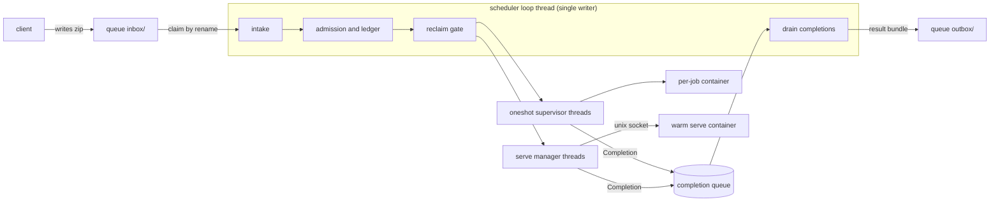

# gpuworker: design

This document describes `gpuworker`, a single-node GPU job broker: what it does, how each
mechanism works, and why. It describes the code in this repository; section 14 lists what
is not implemented. The module author's contract (every `module.toml` field, the worker
environment, serve worker obligations) is in [docs/MODULE_GUIDE.md](docs/MODULE_GUIDE.md).

Section numbers are stable on purpose: code comments cite them (for example "SPEC 9").

---

## 1. Problem

The target machine has one consumer NVIDIA GPU (no MIG partitioning) shared by several
model services: a large model that fills most of the card, smaller models with flat
footprints, and CPU-only steps. If each service runs its own always-on worker that loads a
model and holds it,
two of them up at once collide: one runs out of memory, or the driver spills into system
memory.

Model code is also a risk. Loading a model can execute third-party Python
(`trust_remote_code=True`) or unpickle a checkpoint (`torch.load(weights_only=False)`),
both arbitrary code execution if the files are tampered with.

The approach: one broker owns the GPU, accepts work from its clients (the owner's own
programs), admits it against a VRAM budget, and runs each job in a locked-down container.

## 2. Goals and non-goals

**Goals:** one arbiter of the GPU, so concurrent jobs never over-commit VRAM; a
work-package format any client can write; scheduling that batches by model and evicts idle
models when the card is needed; a per-job sandbox for third-party model code; a terminal
state with a message for every job.

**Non-goals:** multiple GPUs or nodes; hard VRAM partitioning; owning client logic; a
general platform; a multi-tenant or public service.

## 3. Architecture and threading



The broker is one host process (Linux, or WSL2). It never imports torch or module code.

- **The scheduler loop** (`Scheduler.tick`, `scheduler.py`) is the only writer of
  scheduling state: pending jobs, the VRAM ledger (`ledger.py`), jobs parked at the
  reclaim gate, the serve container registry, the watchdog table. No locks are needed.
  Per-job state is keyed by a broker-generated id (`PendingJob.uid`), because a
  submitter's `job_id` is unique only within its own bundle.
- **Worker threads** do the blocking work: a supervisor per oneshot job
  (`oneshot.run_oneshot`) and a manager per warm serve container
  (`serve_manager.run_serve_manager`). They get a `WorkerContext` (`jobs.py`) of
  collaborators that are safe off the loop and report only by putting a `Completion` on a
  thread-safe queue. Exactly one completion is posted per attempt: by its supervisor, or
  by the watchdog or a shutdown when one stops the attempt first (`jobs.Attempt`).
- **Tick order:** drain completions, run the watchdog and the serve load deadline, drain
  again, poll GPU health when due, recover from degraded mode, sample serve peaks, service the reclaim gate, retry
  undelivered results, reclaim stale bundles and archive delivered ones left in
  `processing/`, claim new bundles, admit everything that fits, evict expired warm
  residents. `tick()` is public so tests drive
  the loop with an injected clock.
- **Lanes run concurrently.** `cpu` jobs do not touch the VRAM ledger, so they run while a
  `vram` job is resident.

## 4. Modules and work packages

A **module** declares job types and how to run them; a **work package** is a bundle of
jobs naming declared types. The broker learns what a workload needs from metadata only.

### 4.1 module.toml

A module is `modules/<name>/` with a `module.toml`, a `provision.sh` that builds its venv
in the shared image, and its source in `src/`. Each `[[job_type]]` declares an id
`<module>.<name>`, a lane, `vram_mb`, an `env`, an entrypoint, modes (`oneshot`, `serve`),
a sandbox level and scheduling hints. Fields are documented in
[MODULE_GUIDE section 2](docs/MODULE_GUIDE.md#2-the-module-manifest-moduletoml).

The registry is scanned once at start; a module change needs a broker restart. Registry
load (`module.py`) enforces the rules in MODULE_GUIDE 2.2, among them: serve mode only on
the `vram` lane, a sandbox floor per lane, pinned module images, and no broker-reserved
environment names. An unknown key fails the load, so a misspelled key is caught
instead of keeping its default.

### 4.2 Work package (manifest)

A bundle is a zip of root-relative paths. Each job is a manifest at
`jobs/pending/<job_id>.json`; inputs sit at their own paths.

```jsonc
{
  "schema": 1,                     // optional; newer than the broker's is rejected
  "job_id": "item3",               // [A-Za-z0-9][A-Za-z0-9._-]{0,127}, unique in the bundle
  "job_type": "example.generate",
  "priority": 0,                   // integer in [-1000, 1000], higher first
  "inputs": ["in/prompt.txt"],     // informational; the whole bundle is mounted
  "outputs": ["out/result.bin"],   // the only files collected; regular files only
  "options": {},                   // passed to the worker untouched
  "deliver_to": null,              // client-side delivery path
  "timeout_s": 0                   // 0 = the type's bound; may lower it, never raise it
}
```

- The footprint lives in the job type. There is no per-job VRAM override.
- The only option the broker reads is `options.reset_serve` (section 8).
- `job_id` becomes a host path component, so it must be a plain name.
- Lifecycle fields (`status`, `result`, `finished_utc`, `message`) are reset on intake,
  and `submitted_utc` is replaced with the broker's clock. Each must have the right type
  if present, or the bundle fails.
- Declared outputs are plain relative paths (section 6.3), may not overlap another output
  in the same bundle (`out` and `out/x` overlap), and may not sit under `jobs/` or
  `_gpuworker/`, which the broker writes itself. A job lists at most 10,000 inputs and
  10,000 outputs, and a bundle no more outputs than `max_bundle_members`. The overlap check
  looks up each output's parents in a table, so it is linear in the total path length.
- A manifest's file is `jobs/pending/<job_id>.json`; one under another name fails the
  bundle. The broker rewrites each file from the manifest it validated, so the worker
  reads exactly that.
- `max_priority` in the broker config can cap priority per queue root; a higher value is
  lowered at intake and logged.
- `client.submit` names the bundle `<first job_id>-<UTC stamp>-<8 hex>.zip` and renames
  it into `inbox/` from a `.tmp`, so a resubmitted `job_id` never collides with an older
  result.
- `deliver_to` is honored by the client's `collect`, which can resolve client paths; the
  copy is atomic, so a repeated collect lands the same bytes.

### 4.3 Versioning

- **Manifest schema:** older and current numbers are accepted; a newer one fails the batch
  with a clear message.
- **Serve protocol:** the `ready` frame's `protocol` must equal `PROTOCOL_VERSION`, or the
  container is refused. There is no negotiation.
- **Image rotation:** a new pinned image plus a re-sealed weight cache. Observed footprints
  are stamped per image, so they reset on an image change (section 9).

## 5. Scheduling and admission

- **Lanes.** `vram` jobs are admitted against the VRAM budget, `cpu` jobs against
  `cpu_slots`.
- **Budget.** The admit budget is `gpu_budget_mb - headroom_mb`. A footprint is
  `max(declared, observed)` (section 9). A footprint over the budget on an empty card is
  failed as unschedulable.
- **Serialize by default.** Models usually saturate compute or memory, so a `vram` type
  gets the card alone unless it is packable: `co_resident = true` and
  `vram_profile = "preallocated"`. A `growing` model is never packed, because its peak
  comes mid-job. The intended use of packing is a small helper kept loaded while larger
  models swap.
- **Ordering** (`Scheduler.pick_next`), over currently admittable jobs:
  1. `priority`, higher first;
  2. among equal priority, a job whose model is already resident;
  3. then the highest `queued jobs of the type * load_cost_s`;
  4. then intake order, from a broker counter (a manifest's own timestamp is never used
     for ordering).

  Priority never preempts a running job, and a busy resident is never evicted. While a
  cold `vram` job cannot be admitted, no job of lower priority starts on a loaded model,
  so the model goes idle and can be evicted for it. A warm serve container is handed one
  job beyond the one it is running (`SERVE_QUEUE_AHEAD`), so it never idles waiting for
  the loop; its other jobs stay pending and are ordered with everything else, so a later
  higher-priority job runs after at most those two. Among equal priorities a warm
  container's pending jobs stay admittable, so it drains its backlog before the card
  switches. The cost is fairness: a warm type that keeps receiving equal-priority work
  can hold off a cold type indefinitely (section 14).
- **Eviction.** A non-resident `vram` job evicts idle residents, least recently used first,
  until it fits (`Ledger.eviction_plan`), then parks at the reclaim gate. A oneshot job's
  slot is released when its container exits, so `keep_warm_s` matters mainly for serve.
- **One job at the reclaim gate.** While one job is parked there no other cold `vram` job
  parks (`Scheduler._admittable`). Several cold jobs on an empty card would otherwise all
  park, the ledger would hold back all but the first, and they would time out at the gate
  on a healthy card. Same-type oneshot jobs also serialize while one runs, because each
  container loads its own model copy.

## 6. Sandboxing and trust assumptions

The sandbox is there for model code. Loading a third-party model can run arbitrary code
(section 1), so rather than vet every package and checkpoint, every GPU job runs in a
container that limits what it can reach: no network, no host files beyond its mounts, no
privileges. That protects the host from downloaded model code; it is not an isolation
boundary between tenants. The container does not bound host RAM or disk use (see the known
limits in 6.3).

### 6.1 Container launch

One shared image (`images/Dockerfile.sandbox`) holds every module in its own venv. Each
job, or each warm serve process, gets its own ephemeral container from it; a module may
pin its own image instead.

The launcher (`launcher._ContainerLauncher`) applies the same controls to every container,
whatever the manifest says: `--network none`, `--user` set to `container_user` (default
`1000:1000`, never uid 0), `--cap-drop ALL`, `--security-opt no-new-privileges`,
`--read-only`, `--pids-limit 4096`, and `--cpus` set to host CPUs minus a spare. Serve
containers run with `--rm`. A oneshot container does not, so its `OOMKilled` flag can
still be read after it exits; the supervisor removes it once it has. Oneshot container
names carry an id the broker keeps in `<state_dir>/broker_id`
(`launcher.job_name_prefix`), so at start a broker removes the ones a crashed run of it
left, running or not; of other brokers' and `run-once`'s it removes only exited ones.
`/tmp` is a RAM tmpfs mounted `exec`, because some models JIT-compile kernels there and
`dlopen` them; the model already runs arbitrary code, so `noexec` would add little. Mounts
are limited to the bundle (read-only), the job's own output directory, the weight cache
(read-only), the serve socket directory, the container's own on-disk scratch directory,
created empty at launch and removed after the container exits (`launcher.scratch_dir`),
and, when `GPUWORKER_CUDA_CACHE_DIR` is set, the job type's read-write CUDA and inductor
cache at `/cuda-cache`. There is no `--memory` cap, because a model-load transient can
approach host RAM. Argv goes to the runtime without a shell. Only `vram` containers get a
GPU: the one at `gpu_index`, the NVML index that CDI device names and `--gpus device=`
also use. Under Docker the `--gpus` value asks for the `compute,utility` driver
capabilities only; under Podman the generated CDI spec decides which driver libraries are
mounted. A `cpu` container gets no device and `NVIDIA_VISIBLE_DEVICES=void`. Podman (CDI)
and Docker (`--gpus`) differ only in how the GPU is injected. The worker environment is in
[MODULE_GUIDE 3.1](docs/MODULE_GUIDE.md#31-oneshot-one-process-per-job).

**Image pinning.** Pinned means a registry digest (`repo@sha256:<64 hex>`) or a local image
id (`sha256:<64 hex>`). Module images must be pinned. The shared `sandbox_image` may be a
tag only with `allow_unpinned_images = true`, and a `strict` type refuses a tag regardless
(`module.resolve_image`).

**Environments.** `env = "container"` gets the controls above. `env = "host"` runs a host
subprocess through the local launcher with a minimal environment allowlist and no
isolation; it is refused on the `vram` lane and cannot be `strict`. `container_runtime =
"local"` would run container types as host subprocesses too, so it refuses every container
type unless `allow_unsandboxed_containers = true` (`Scheduler._unsandboxed_refusal`). The
tests and the quick start use it with host-process types.

**Sandbox levels** are declarations checked at registry load and launch: `none` (no model
code, off the `vram` lane only), `standard` (safe loaders, the `vram` minimum), `strict`
(remote code or pickled checkpoints; container and pinned image only). The container
controls are the same at every level.

### 6.2 Weights

Containers have no network, so weights are staged on the host per job type
(`<weights_dir>/<job_type_id>/`). `gpuworker stage-weights` hashes every file into
`weights.sha256`, skipping downloader logs and locks. If a seal exists, the broker
re-hashes the tree before every oneshot launch and each serve container's first start, and
fails the job before any process exists on a missing, extra or changed file
(`Scheduler._weights_for`). `weights_required = true` also fails a missing or unsealed
cache, on any lane; `strict` implies it. The cache is mounted read-only with `HF_HOME` and
the offline variables set.

The seal protects integrity against drift: a partial copy, an in-place edit, a re-download
that changed a file. It is not tamper resistance. `weights.sha256` lives in the tree it
covers, so anyone who can write the cache can re-seal it, and write access to `weights_dir`
must stay with the host admin.

### 6.3 Trust assumptions

The clients, the module registry and the broker are the owner's own and are trusted. What
the sandbox contains is model code and weights from third parties. The registry
configures the sandbox (each type's lane, sandbox level and image), so only the host admin
should write it; the broker enforces pinned images, the per-lane sandbox floor and its own
mount, network and user policy. A `host` type such as `echo.echo` runs on the host, so
beside a container runtime it runs only if the config sets `allow_host_jobs = true`.

The checks on bundles, paths and queue directories are there for mistakes. The queue
directories are file shares that other programs and machines write to, so a mistake there
(a stray link, a moved directory, a reused bundle name, a path written two ways, a link a
model left in its output) must fail with a reason, not redirect the broker's own reads and
writes. Those programs write while the broker reads, so a check made by path could be true
when made and false when acted on. That is why the broker pins each queue directory by
file descriptor, opens files without following links, and connects to a serve socket
through an `O_PATH` descriptor where the OS has them. The broker also keeps its working
files in its own `state_dir`, which may not overlap a queue root; accepts a path, in a
manifest or as a bundle member name, only in its one canonical spelling, and compares
output paths case-folded; validates the manifests from the unpacked files a worker reads
and rewrites them from what it validated; reads every file a job wrote without following
links; and gives each serve attempt directories named by the broker's id for it, never by
the client's `job_id`. Manifests (`JobManifest.from_dict`) and serve results
(`serve.parse_result`) are checked field by field. The checks live in a few functions,
whose docstrings say how each works: `manifest.is_bundle_path`, `bundle.unpack`,
`bundle.read_unpacked_manifests`, `bundle.safe_join`, `bundle.open_regular`,
`bundle.write_new`, `share.QueueDir`, `QueueTree.claim` and `serve.connect`. What the
broker reads is bounded too: unpacking stops at `max_bundle_members` entries or
`max_bundle_mb` of bytes actually written, each file it copies back at `max_output_mb`,
and captured stdout and stderr are clipped (the worker log, section 11).

Known limits:

- The GPU driver is shared by host and containers, and the NVIDIA container toolkit's
  hooks run with host privileges for every GPU container.
- The opt-in CUDA and inductor cache is a read-write directory per job type, and later
  jobs of the same type reuse compiled kernels from it. Types do not share it.
- A serve process keeps state between jobs: every job of its type runs in that one
  process, one after another, so a job can see what an earlier one left.
- Jobs in one bundle share its input directory.
- Membership in the `docker` group is root-equivalent on the host. Rootless Podman would
  avoid that, but the launcher does not yet pass what it needs (section 14).
- Host-process jobs have no isolation.
- There is no RAM ceiling per container and no disk ceiling per job: `max_output_mb`
  caps each returned file, but the scratch and output directories are not capped, so a
  runaway job can fill the host's memory or disk.
- Where the OS lacks directory-fd calls or `O_PATH` (Windows, and macOS for the serve
  socket), the link checks are made and then acted on in two steps.

## 7. Queue transport

- **Layout:** `inbox/`, `processing/`, `outbox/`, `archive/`, `failed/` under each entry of
  `queue_roots`.
- **Atomic claim** from `inbox/` to `processing/`, by a hard link and an unlink that
  never replace an existing file (a rename where the share has no hard links); the winner
  owns the bundle. A name already in `processing/`, or with a result in `outbox/` or
  `archive/`, is refused: the entry moves to `failed/` under a new name with a reason file,
  and no result is written, because the outbox name belongs to the earlier bundle. The
  claim stamps mtime, so staleness counts from claim. Only `*.zip` is claimed, at most
  `max_claims_per_tick` per tick.
- **State outside the tree.** Each claimed bundle unpacks into its own directory under
  `<state_dir>/batches/`; serve containers get one under `<state_dir>/serve/`. `serve`
  clears both at start, since their bundles are back in `inbox/` by then or have results.
- **Result bundle:** written atomically to `outbox/` under the input's name, with the
  terminal manifests, declared outputs that exist, and a worker log per job. The input
  moves to `archive/` only once a result is written (section 10).
- **Batch failure** (`QueueTree.fail_batch`): a bundle that cannot be unpacked, has a
  duplicate `job_id`, an unreadable manifest or an unknown type still reports every job as
  `failed`, from manifests read straight out of the zip, plus one synthetic entry for each
  of the first 100 manifests that could not be read. With nothing readable at all, one
  synthetic entry is keyed on the filename. The bundle moves to `failed/` with an
  `.error.txt`. If even that result cannot be written, the bundle stays in `processing/`
  for stale reclaim and the loop carries on.
- **Stale reclaim** (`QueueTree.reclaim_stale`): a bundle in `processing/` longer than
  `reclaim_after_s` returns to `inbox/`, unless the broker is processing it, a result
  already exists in `outbox/` or `archive/`, or a new bundle of that name is already in
  `inbox/`. The broker warns when a type's timeout, or a bundle's summed timeouts, exceed
  the window.
- **`broker_limits.json`** is written into each queue root when `serve` starts
  (`Scheduler.run`, not the constructor, so `gpuworker status --snapshot` writes nothing
  there): the
  reclaim window and each type's timeout in the mode it actually runs in.

## 8. Serve mode (protocol)

One warm container per job type (`vram` lane and `container` env only), receiving jobs over a
socket.

- **Transport:** a unix socket in a per-container host directory, bind-mounted at the
  directory of `serve_socket`. No TCP, so `--network none` holds.
- **Framing:** 4-byte big-endian length, then a UTF-8 JSON object, at most 8 MiB.
  Anything else is a `ProtocolError`, including a document nested deeply enough to
  exhaust the parser.
- **Messages:** worker sends `{"type":"ready","protocol":N}` once, then one
  `{"type":"result","job_id","status","outputs","message"}` per job, with an optional
  `"error"` of `"cuda_oom"` or `"cuda_error"` on a failed result; broker sends
  `{"type":"run","job_id","manifest"}` and `{"type":"unload"}`. Result fields are
  type-checked (section 6.3).
- **Direction:** the worker listens and accepts one connection; the broker connects
  (retrying for `serve_connect_timeout_s`) and waits `serve_ready_timeout_s` for `ready`.
  Both waits, and a job's wait for its result, are deadlines for the whole frame rather
  than per read, so a worker sending a byte at a time cannot stretch them.
- **Load deadline:** no job watchdog is armed until a container's first job starts, and a
  loading container holds its VRAM slot. So the loop gives each load (and each recycle,
  with `reclaim_timeout_s` added for its memory wait) the connect and ready timeouts plus
  30 s, and past that retires the container as for a hung job
  (`Scheduler._retire_hung_serve`), whatever its manager thread is stuck on. The jobs
  waiting in it spend a retry, since a model that never loads would otherwise be retried
  forever.
- **Data path:** each attempt is staged into `bundle/<key>/` and writes `out/<key>/`, where
  `<key>` is the broker's id for the attempt, sent as the run frame's `job_id` (the
  client's id stays in the manifest; section 6.3). The broker copies declared outputs back
  with the no-follow reads of section 6.3. Jobs run one at a time. The container log goes
  to a file, not a pipe a verbose server could fill; each job's slice ships in its result,
  and between jobs the file is emptied once it passes `SERVE_LOG_MAX_BYTES`.
- **Epochs:** containers are named `gpuworker-serve-<job_type>-<epoch>`. The epoch stops an
  evicted container's trailing force-remove from killing its successor, and every
  manager-to-loop message carries it so stale messages are dropped. At start the broker
  removes leftovers with its own prefix; `run-once` uses a different prefix.
- **Failure:** a timeout, protocol error or broken socket tears the container down
  (an `unload` frame if it can be sent within `serve.UNLOAD_TIMEOUT_S`, then `SIGTERM`,
  grace, `SIGKILL`, forced remove), so a worker that has stopped reading its socket is
  removed all the same. A timeout fails the job without retry; a
  protocol error or broken socket is an infrastructure failure. Either way the jobs queued
  behind it never started, so they are re-queued without spending a retry; the failure is
  charged to the job that was running. A staging or collect error fails only that job.
  Startup failures (connect, `ready`) fail all queued jobs as infrastructure, with the
  container log tail; a configuration error found before launch (unsealed weights, an
  unusable image) fails them as final. Whenever a live container is being torn down
  (an infrastructure failure or a timeout) the loop marks it `dying`: it takes no new
  work, and its type waits for `serve_gone` before a new container starts.
- **CUDA errors:** a `cuda_error` result tears the container down like a crash, so a
  process whose CUDA context is unusable is never kept warm. A `cuda_oom` result fails
  only that job: the worker has freed what the job allocated and stays up, so a model
  that is slow to load is not reloaded for it. Whether the job is retried, on a fresh
  process or on the same warm one, follows section 10.
- **A hung manager:** if a job outlives its watchdog (section 10), the manager is stuck
  outside the socket timeout, for example in stage-in on a dead share. The loop retires
  the container itself (`Scheduler._retire_hung_serve`): it frees the slot, re-queues the
  jobs waiting in it without spending a retry, and force-removes it by name off the loop
  thread. The reclaim gate still waits for its memory before the next load.
- **Recycle:** before a job, if `options.reset_serve` is set or `serve_max_jobs` is reached
  (and a job has run since the last load), the manager unloads, stops the container, waits
  for NVML free memory to cover footprint plus headroom, relaunches under the same name and
  epoch, and waits for `ready`. The ledger slot is kept throughout. The free-memory target is
  a value the loop hands the manager (`ServeContainer.respawn_free_target_mb`), refreshed
  after footprint reconciliation, so the manager never reads loop-owned state. If the wait
  times out, the container is torn down and the GPU is marked degraded, as for the
  admission gate.

## 9. VRAM accounting and the reclaim gate

- **Truth sources.** The ledger is the admission authority. NVML (or `nvidia-smi`) is the
  reclaim and reconciliation signal, because it is the only view of what the driver has
  actually released. The broker reads it as device-wide totals. On WSL2 that is all NVML
  offers, so usage cannot be split per model there; native Linux reports per-process
  usage, and using it is future work (section 14).
- **The gate.** A container's exit does not mean its CUDA context has released memory. A
  non-resident `vram` job is admitted only when NVML free memory is at least `footprint +
  headroom_mb` **and** the ledger agrees it fits (`Scheduler._service_reclaim`). The job
  parks with a deadline instead of blocking the loop and is re-checked each tick after
  completions drain. At most one parked job is admitted per tick, because NVML lags
  admission, and only one job is parked at a time (section 5). A job for an already-warm
  serve container skips the check. While a serve container the job evicted is still
  tearing down, the deadline keeps moving: it is `reclaim_timeout_s` from when the last
  such container reported gone, or from `SERVE_TEARDOWN_BOUND_S` after the eviction if it
  never does, because unloading a large model can take longer than the gate allows.
- **Unschedulable.** A job whose effective footprint is over the admit budget, or over
  what the card has free when idle (total minus the idle baseline, less `headroom_mb`),
  fails at admission as unschedulable. Waiting at the gate for it would only time out and
  mark a healthy card degraded. At start the broker logs `gpu_budget_exceeds_card` if
  `gpu_budget_mb` is larger than the card.
- **Degraded mode.** A parked job whose ledger no longer has room is unparked, since that
  says nothing about the card. If the ledger has room but NVML does not show the memory
  free by the deadline, the job fails as an infrastructure failure, the GPU is marked
  degraded, and `vram` admission stops until device usage returns to an
  idle baseline captured while the card was healthy and nothing ran on it (no resident,
  no `cpu` job), plus residents and a small slack
  (`Scheduler._recover_degraded`). A serve recycle whose wait times out has the same
  effect (section 8). Queued `vram` jobs, including re-queued ones, wait while degraded.
  For a model that nearly fills the card, set
  `headroom_mb` low, since other processes' usage also counts against free memory.
- **Footprint reconciliation.** When a type loads with nothing else on the GPU (no other
  resident and no running `cpu` job, because host-process jobs on any lane can use the
  GPU), the broker samples peak usage over a pre-load baseline (oneshot on the supervisor
  thread, serve once per tick). Any job starting on the GPU during the measurement
  discards it. For a serve container that is for good: once anything else has run beside
  it, its pre-load reading cannot be taken again with the model loaded, so its footprint
  is no longer reconciled and its later out-of-memory failures count as not its own and
  are retried (section 10). That errs toward a retry on purpose. A oneshot run is
  reconciled when it ends; a serve container after every job that finishes, because a
  `growing` model's peak can come on any job, and the resident's ledger entry takes the
  new size. The observed peak is persisted to `footprints.json`, only ratchets upward, and
  feeds `max(declared, observed)`. A CUDA out-of-memory failure is logged as `cuda_oom`
  with the peak but not recorded: at that point the peak is what the card had, not what
  the model needs. An overshoot beyond `footprint_variance_tol` logs `footprint_variance`.
  An observation above the whole admit budget is rejected (`footprint_rejected`) rather
  than recorded, because one contaminated sample would otherwise make the type
  unschedulable; `gpuworker footprints reset <type>` clears a recorded value that turns
  out wrong. Observations are stamped with their image and discarded when it changes;
  otherwise a rebuild that shrinks a model would stay latched to the old peak and the gate
  would keep demanding memory the model no longer needs.

## 10. Reliability

- **Terminal guarantee.** While the broker runs, every job it claims ends `done` or
  `failed` with a message. Batch-level failures report every job (section 7), with one
  exception: a bundle over the member limit, or one whose manifests cannot be read, gets a
  single failed entry for the whole bundle, since its jobs cannot be listed safely. A
  supervisor's `finally` posts a failure if nothing else did, and a watchdog
  (`Scheduler.check_watchdog`) fails any job whose thread missed its deadline. A worker
  that exits 0 without every declared output is `failed`. Two cases end otherwise: a
  bundle without a result when the broker stops or crashes stays in `processing/` and runs
  again after a restart, once it is older than `reclaim_after_s`; and a result that can
  never be written moves its input to `failed/` (delivery, below). The guarantee assumes
  the job can be scheduled: while the GPU is marked degraded, VRAM jobs wait for it to
  recover rather than fail.
- **Stopping a oneshot attempt.** A oneshot job is reported only once its worker is gone,
  so its ledger slot is not freed while its model still holds memory. At the job's own
  timeout the supervisor terminates the worker and waits for it; the watchdog and a
  shutdown stop it the same way from outside (`oneshot.stop_attempt`, off the loop
  thread). Gone means the process exited and the runtime says there is no such container
  (`oneshot.worker_gone`); an inspect that fails any other way, as with a daemon that is
  restarting, counts as still there. Both terminate paths swallow their errors, so this is
  checked rather than assumed. The container is named from the attempt's own number, so
  its stop and removal never reach a retry's container. The attempt's handle
  (`jobs.Attempt`) makes a stop and the supervisor agree on who reports, and a supervisor
  stopped before it launched starts nothing. A worker still there after
  `oneshot.STOP_WAIT_S` is reported anyway, with a note; on the `vram` lane the GPU is
  then marked degraded until its memory shows free.
- **Delivery.** If packing outputs fails, a manifest-only result is written and the input
  archived, and every job whose outputs did not arrive is reported `failed` with that
  reason rather than `done`. If no result can be written at all, nothing is archived or
  deleted: the batch keeps its `processing/` file, its outputs and its place in the active
  set, and the write is retried every 30 s and once more at shutdown. Its unpacked input
  and attempt directories are removed meanwhile. After `RESULT_ATTEMPTS` failed writes the
  broker gives up: it logs `result_abandoned` and moves the input to `failed/` with an
  `.error.txt`, so stale reclaim cannot run it again. Across filesystems that move is a
  copy and an unlink; if the unlink fails the copy is removed and the batch stays tracked,
  as if the move had failed. A batch still undelivered when the broker exits is re-run
  after a restart by stale reclaim. If the input cannot be archived after delivery, it
  stays in `processing/`, and every reclaim pass archives bundles there that have a result
  and no live batch (`QueueTree.archive_leftovers`); stale reclaim skips them because they
  have a result. When the share cannot say whether a bundle has a result
  (`QueueTree.has_result` raises rather than answer "no"), reclaim leaves it for the next
  pass.
- **Timeouts.** Oneshot: `oneshot.oneshot_timeout` (the type's `oneshot_job_timeout_s`,
  else `default_timeout_s`); on overrun the container is killed and its output kept for
  the log. Serve: `serve_job_timeout`. A manifest's `timeout_s` may lower either bound for
  its job, never raise it; a larger value is lowered at intake and logged
  (`timeout_capped`). The watchdog arms from the same value plus a margin, so the two
  cannot drift: for a oneshot job one that covers the supervisor's own stop
  (`ONESHOT_WATCHDOG_SLACK_S`), for a serve job `serve_stage_slack_s` plus 30 s, armed when
  the job starts in the container.
- **Retry: failures classified as infrastructure**, up to `max_retries` (default 1, `0`
  disables). The classification is by exit code and event, and a workload can produce
  some of the same codes: a job that exhausts host memory is OOM-killed and exits 137 like
  any other. Classified as infrastructure: the launcher raised or a worker thread could
  not start; exit 137 or -9 (killed from outside, usually an OOM-kill); a serve container
  failed to start, failed to recycle, or died; a reclaim-gate timeout. For a container
  that exited 137 the result names what the runtime's `OOMKilled` flag said. The flag
  can miss a kill by the host's OOM killer on cgroup v1, so a "no" is reported, not used
  to change the classification.
- **CUDA failures** (exit 75 or 76, or a serve result with `error` set) are retried only
  when a retry can change the outcome. An out-of-memory failure is retried only if the
  job did not have the GPU to itself: another job used the GPU during the attempt, or
  memory outside the ledger was in use when it started (its pre-load reading above the
  idle baseline plus slack). Otherwise a retry meets the same free memory, so the job
  fails with a note to ask for less or raise `vram_mb`. A serve job's retry runs on the
  same warm container (section 8).
- **GPU health.** After any other CUDA error, and after a `vram` job times out, is stopped
  by the watchdog, is killed or dies on a signal (a negative exit, or 129 to 192 from a
  container runtime), the loop asks the monitor for `hardware_faults()`: whether the card
  still answers and, with NVML, new uncorrected ECC errors, a failed or pending row remap,
  or a critical Xid that NVIDIA lists as a hardware fault; with `nvidia-smi`, the ECC and
  row-remap counters it reports. A monitor that reports the GPU lost (NVML's
  `GPU_IS_LOST`, or `nvidia-smi` saying so) counts as a fault too. A fault fails the job
  without a retry and marks the GPU degraded until the broker restarts (`gpu_fault` in
  `status.json`); free memory says nothing about a failing card. The loop also polls every
  `HEALTH_POLL_S`. A query that fails for any other reason is asked once more, and if it
  fails again the GPU is marked degraded only until it answers: a slow `nvidia-smi` after
  a hung job is not a hardware fault. Consumer cards and WSL2 report few of these
  counters, and the Xid list is a judgement, not a complete catalogue.
- **Queued jobs and final failures.** Jobs queued behind a serve container that died,
  or was retired after a hung job, are re-queued without spending a retry; after a load
  timeout they spend one (section 8). Everything
  else is final: non-zero exit, a `failed` result, missing outputs, timeouts of either mode
  (`serve.ServeTimeout` separates a serve timeout from a crash). For a container job,
  exit 125 means the runtime itself failed (for example it could not create the
  container) and counts as infrastructure. A retry re-runs the same bundle and options in a
  fresh output directory, so it can only succeed on files it writes itself.
- **Quarantine.** A job that fails on infrastructure on every allowed attempt gets a
  `[quarantined: ...]` note and is never re-queued.
- **Stale reports.** Each completion carries its attempt number; reports from a superseded
  attempt are dropped, so they cannot finish or double-count the new one. Serve reports are
  also checked against the container epoch.
- **Shutdown** stops intake, tears warm containers down and gives running oneshot jobs
  until the same deadline (20 s) to finish. Then it stops the rest (above), reporting each
  `failed` with "the broker shut down before the job finished", and drains completions so
  jobs reach a terminal state. Nothing is re-queued while shutting down: an
  infrastructure failure processed then fails with a "not retried: the broker is shutting
  down" note. Jobs that had not started stay with their bundle in `processing/`.
  `gpuworker serve` stops on SIGTERM or SIGINT through this same path
  (`cli.install_stop_handlers`), so a systemd stop tears warm containers down.
- **One broker per state directory.** Startup clears `batches/` and `serve/` and reaps
  serve containers, so `Scheduler.run` first takes an exclusive lock on
  `<state_dir>/broker.lock` (`lock.BrokerLock`), held until the process exits. A second
  broker on the same `state_dir` refuses to start and names the PID that holds it. The
  lock is also what makes the id in `<state_dir>/broker_id` (section 6.1) this broker's
  alone.
- **Loop errors.** An exception that escapes a loop iteration is logged as `tick_error`
  with its traceback and how many iterations in a row have failed, and the last one is in
  `status.json` (`last_loop_error`) until an iteration succeeds. While every iteration
  fails, the loop doubles its wait, up to `TICK_ERROR_BACKOFF_MAX_S`, so a lasting error
  does not flood the log.

## 11. Observability, config and CLI

- **Event log:** JSON lines per `job_id` (`claimed`, `claim_rejected`, `reclaim_pending`,
  `running`, `retry`, `quarantined`, `cuda_oom`, `watchdog_timeout`, `worker_not_stopped`,
  `done`/`failed`, `result_write_failed`, `result_abandoned`, `gpu_fault`,
  `gpu_unanswered`, `tick_error`, `left_in_processing` (at start, with when the bundle
  runs again), footprint and serve events such as `serve_retired`). Logging never raises
  into the scheduler.
- **`status.json`**, refreshed every loop: its time (`ts`), device VRAM, the ledger, the
  degraded flag with its reason and any GPU fault, footprints per type, inbox depths, and
  the last loop error, cleared by the next clean iteration.
- **Worker log** at `_gpuworker/<job_id>.log` in each result: stdout and stderr clipped at
  both ends, plus the outcome. While a worker runs, the broker keeps the first 256 KiB and
  the last 1 MiB of each stream (`oneshot.STREAM_HEAD_BYTES`, `STREAM_TAIL_BYTES`); the
  log keeps 200,000 characters of each, half from each end (`worker_log.WORKER_LOG_CAP`).
  The other documents link here for these limits. It sits under a reserved prefix, not in
  `outputs`, so it cannot satisfy the declared-outputs check.
- **Source fingerprint.** The registry hashes each module's `src/` on the broker host at
  scan time, and every worker log records it. That is the staged source, not proof of what
  ran, which comes from the image. A worker that prints its own `src_sha256=<hex>` gets a
  line saying whether the two match ([MODULE_GUIDE 1.5](docs/MODULE_GUIDE.md#15-is-the-broker-running-your-code-two-fingerprints)).
- **Config:** `gpuworker.toml`, with every key and default in `gpuworker.example.toml`.
  Relative paths resolve against the broker's working directory. Unknown keys are rejected and every value's type is checked at load. Load also fails on
  a zero capacity or wait (`cpu_slots`, `max_claims_per_tick`, `tmpfs_mb`, the timeouts),
  a NaN or infinite number, a root `container_user`, `reclaim_after_s <=
  default_timeout_s + 60`, or an admit budget that is not positive. Module fields are
  checked the same way at registry load: a NaN `serve_job_timeout` would make a watchdog
  deadline no clock passes. A
  `--config` path that does not exist is an error.
- **Broker environment:** `GPUWORKER_CPU_SPARE`, `GPUWORKER_MEM_SPARE_MB`,
  `GPUWORKER_SCRATCH_DIR` (the scratch root; empty disables scratch),
  `GPUWORKER_CUDA_CACHE_DIR` (opt-in persistent JIT cache).
- **CLI** (`gpuworker` or `python -m gpuworker`): `serve`, `doctor`, `run-once`, `status`,
  `registry list|validate`, `stage-weights`, `verify-weights`, `footprints reset`.
  `run-once` runs one job through a temporary queue, with its own serve container prefix,
  its own state directory and private copies of the footprint and status files, so it can
  run beside a live broker. `status` prints the live `status.json` and never writes it,
  says on stderr how old it is, and exits 1 once it is older than `cli.STATUS_STALE_S` or
  while it says the GPU is degraded; `status --snapshot PATH` builds one from the config
  without a broker, to a path other than `status_path`. `doctor` also checks free disk
  space in `state_dir`, `weights_dir` and each queue root, lists each job type whose image
  does not resolve, and says when it skipped the sandbox GPU probe because an earlier
  check failed.

## 12. Key decisions

1. **Containers for every GPU job.** Package and model-code risk is contained by default
   rather than vetted per package. The `host` env remains for trusted code off the GPU and
   for development; the registry refuses it on the `vram` lane and for `strict`.
2. **Podman by default, Docker as a drop-in.** Podman is daemonless and can run
   rootless, which would take the root-equivalent `docker` group out of the picture.
   The launcher does not yet pass the options rootless operation needs (section 14).
3. **A file-share queue.** Any client that can write files can submit, the claim is an
   atomic rename, and the queue survives restarts with no extra service. The cost is
   polling, acceptable on one machine.
4. **A single-writer loop with reporting-only threads.** Admission and accounting live in
   one place without locks and can be tested tick by tick; a wedged container can delay
   its own report but cannot corrupt shared state.
5. **The ledger admits, NVML checks.** The broker reads NVML as device-wide totals (on
   WSL2 that is all it offers), so NVML gates loads and corrects footprints upward but
   never replaces the declared numbers.
6. **Retry only what the broker broke.** Generation is not idempotent, and a silent second
   run of a job that produced bad output would hide the problem. One retry, then
   quarantine, covers transient OOM-kills and container deaths without masking job bugs.
7. **Sealed, read-only weights**, re-verified before launch, so a `strict` loader runs
   the bytes that were sealed. The seal guards against drift, not against someone who can
   write the cache (section 6.2).
8. **One shared image.** The container is the boundary, so per-module venvs in one image
   cost no isolation.
9. **Generic per-type settings.** Behavior one model needs becomes a validated
   `module.toml` key (`serve_max_jobs`, `env_passthrough`), never a branch on a job type id.

## 13. Notable failures and what changed

These failures happened in the private broker this code was rewritten from, on the
author's GPU host. Each change described is carried into this version.

**A truncated log hid the root cause.** A library copied a shared object into a new temp
directory on every initialization until the RAM-backed `/tmp` filled, and a caller
re-raised the `ENOSPC` as an unrelated load error. The failure message kept only the tail
of stderr, which held the re-raise. Changed: `TMPDIR` points at a
per-job directory on the on-disk scratch mount, not a larger tmpfs that would spend host
RAM (`launcher._env_args`); logs are clipped at both ends (`worker_log.clip_both_ends`);
the full worker log ships in every result (`worker_log.write_worker_log`).

**Stale reclaim re-ran completed jobs.** Reclaim treated age in `processing/` as proof of
abandonment. After a restart erased the in-memory set of active bundles, completed bundles
were re-queued and their outputs overwritten. Changed: a bundle with a result is never
reclaimed (`QueueTree.has_result`); the broker warns when timeouts can outlive the window
and publishes `broker_limits.json`.

**A batch of same-type jobs loaded together.** Same-type oneshot jobs serialized only once
one was resident. On an empty card the whole batch passed admission, parked at the gate
together, then loaded one model copy each and was OOM-killed. Changed: while one job of a
type is parked, the rest wait (`Scheduler._admittable`).

**Jobs ran old code with plausible output.** The broker resolves the image by pinned digest,
so a rebuild and retag did not change what ran, and nothing in the results said so.
Changed: every worker log records the staged `src/` fingerprint, plus a match or mismatch
line when the worker reports its own (`module.source_fingerprint`,
`worker_log.runtime_vs_staged`).

**Degraded mode could not clear.** Recovery required device usage near zero, but NVML
counts a desktop compositor that never releases its memory, so one reclaim timeout
disabled `vram` scheduling until restart. Changed: recovery compares against an idle
baseline (`Scheduler._recover_degraded`).

**A retry went back to a dying container.** After a serve container reported an
infrastructure failure, the loop could dispatch the retried job into it before its
`serve_gone` arrived, spending the retry and quarantining the job with the wrong reason.
Changed: the container is marked `dying` and takes no new work; its type waits for a fresh
container (`ServeContainer.dying`, `Scheduler._warm_serve`, `Scheduler._on_complete`).

## 14. Status and limits

This code is a rewrite of a broker the author ran on a GPU host for their own work. Its
tests need no GPU and no container runtime (`MockGpu` and the local launcher).

Not implemented, or only partly:

- Priority aging, and with it any fairness bound: a warm serve type with a steady stream
  of equal-priority work can starve a cold type (section 5).
- Per-process VRAM attribution on native Linux (section 9).
- No drain command: shutdown stops intake, but there is no way to stop taking bundles
  while letting running work finish.
- Intake limits cap member count and extracted bytes, but unpacking still runs on the
  scheduler thread, so a large legal bundle delays that tick.
- Rootless Podman: containers run as `--user <container_user>` with no
  `--userns=keep-id` and no SELinux relabel, which a rootless setup needs before the
  container can write its output mount.
- The GPU is named by index (`gpu_index`), which CDI, Docker and NVML number alike on
  one host; naming it by UUID would be safer across driver changes. `gpuworker doctor`
  checks that the CDI spec names the device by index.
- The claim's hard link has no equivalent on shares without hard links; there it falls
  back to an existence check and a rename, which is not safe for two brokers draining
  one tree.
- The Windows fallbacks in `bundle.open_regular` and `share.QueueDir` check and then act
  in two steps (section 6.3).
- No warning for a queue with work but no activity; a waiting client only times out.
- GPU queries run on the loop thread. An `nvidia-smi` call has a 10 s timeout but an NVML
  call has none, so a wedged driver stalls the scheduler; the stale `status.json` age
  then shows it.
- **Weight verification cost.** A sealed cache is fully re-hashed before every oneshot
  launch and every serve container start, which is slow for a multi-GB cache and sits on
  the job's critical path. It was accepted because the seal exists for `strict` loaders,
  where what matters is that the executed bytes match the sealed ones at launch; a size or
  mtime shortcut would miss an in-place edit. Serve mode pays it once per container.
